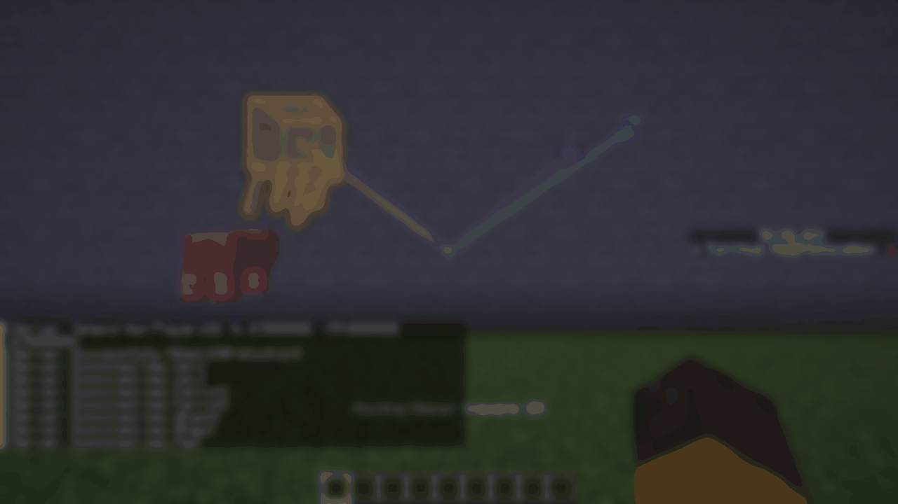
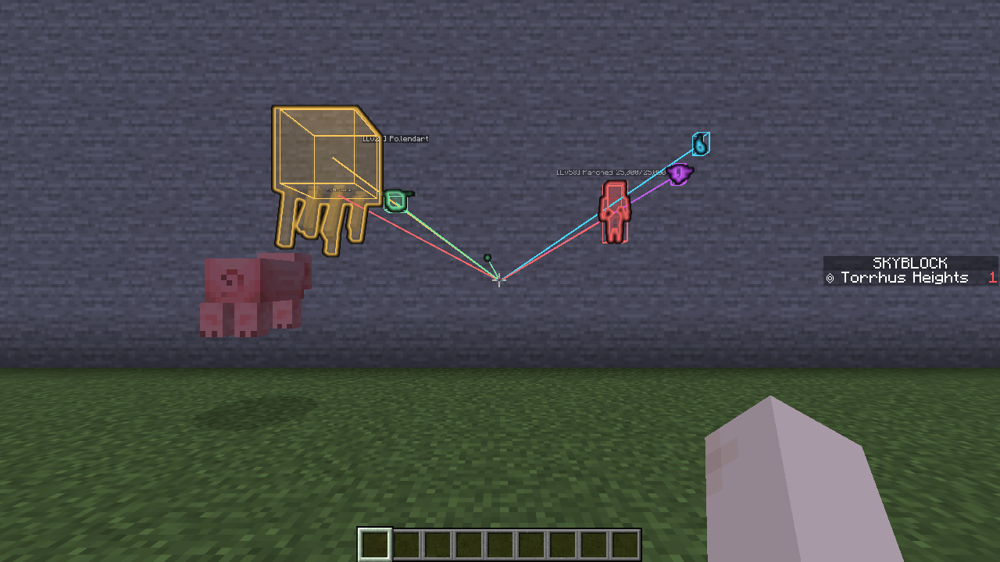

# Hunting Helper

Hypixel SkyBlock mob tracers, matching boxes and through-wall model glow for Minecraft 26.2 / Fabric.

A matte black interface with small icons, quiet borders and independent controls for every tracker.
All five fit at the usual GUI size; smaller windows scroll and support keyboard navigation.

**Vex · Blue Jay · Hivethief · Parched · Pollendart**

Choose each mob's **Line** and **Glow** colors. Glow can **Match line**, use a separate color, or turn **Off**.
Your selections and colors persist.

## Controls

- **`/hh`** or **`/huntinghelper`** opens settings.
- **V** toggles selected trackers; **F1** hides overlays.
- **Select all / Clear all** changes the selection.
- **`/hh debug`** toggles diagnostic logging.

Every loaded entity across the full render distance is checked on every client tick.
Hypixel nametags identify mobs; Vex, Blue Jay and Hivethief retain their original type fallback.
Blue Jay, Hivethief, Parched and Pollendart apply in Torrhus.

## Install

**Minecraft 26.2 · Java 25 · Fabric Loader 0.19.5+ · Fabric API 0.161.0+26.2**

[Download Hunting Helper 1.4.0](https://github.com/SleepCodeX/foragingPuckGrinding/releases/download/v1.4.0/hunting-helper-1.4.0%2Bmc26.2.jar)
and replace the older tracer JAR in `mods`.

[Visual guide](docs/media/1.4.0) · [Build and behavior](docs/DEVELOPMENT.md) · [Release downloads](https://github.com/SleepCodeX/foragingPuckGrinding/releases/latest)

Automated checks run the packaged Minecraft client. Live Hypixel, third-party shaders and the complete personal modpack are not reproduced by CI.
