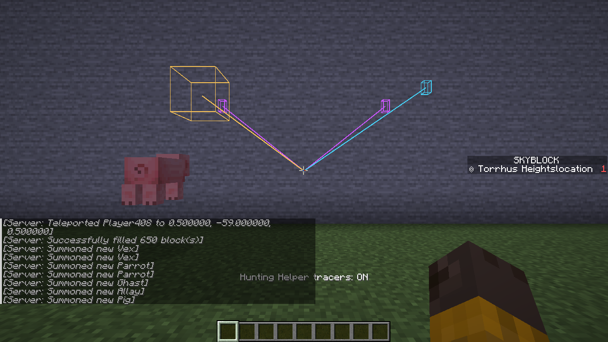
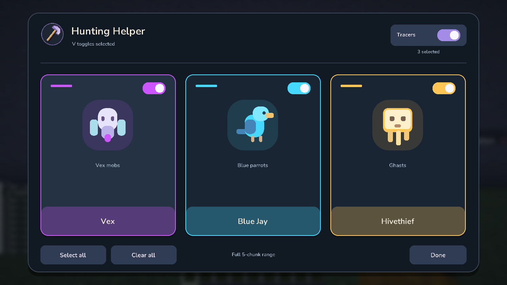

# Hunting Helper

OneClient-inspired controls for colored mob tracers and matching boxes.

**Purple Vex · Cyan Blue Jay · Gold Hivethief (Ghast)**

Open **`/huntinghelper`** to choose mobs. Toggle them separately or use **Select all / Clear all**.
**V** toggles your selection; **F1** hides the overlays.

Scans the full loaded render-distance area, including corner chunks.
Blue Jay and Ghast tracking apply in Torrhus.

## Install

**Minecraft 26.2 · Java 25 · Fabric Loader 0.19.5+ · Fabric API 0.161.0+26.2**

Put [Hunting Helper 1.2.0](https://github.com/SleepCodeX/foragingPuckGrinding/releases/download/v1.2.0/hunting-helper-1.2.0%2Bmc26.2.jar)
in `mods`, replacing the older tracer JAR.

[Source code](src) · [Build it yourself](docs/DEVELOPMENT.md) · [Downloads](https://github.com/SleepCodeX/foragingPuckGrinding/releases/latest)
