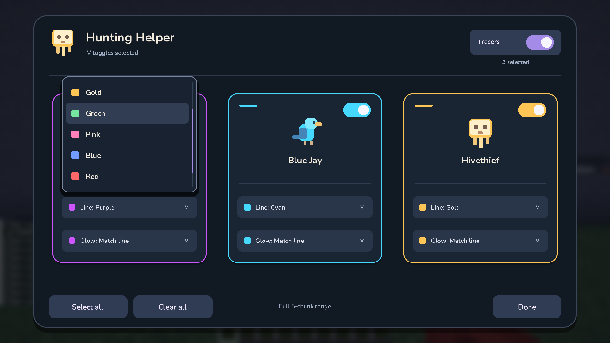

# Hunting Helper

OneClient-inspired controls for mob tracers, matching boxes and through-wall glow.

Choose each mob's **line** and **glow** colors from scrollable dropdowns.
Glow can **Match line**, use its own color, or turn **Off**.

**Purple Vex · Cyan Blue Jay · Gold Hivethief · Red Parched · Green Pollendart** by default.

Open **`/huntinghelper`** or **`/hh`**. **V** toggles your selection; **F1** hides all overlays.
Scans the full loaded render distance. Mobs are recognized by their Hypixel nametag;
Blue Jay, Hivethief, Parched and Pollendart tracking apply in Torrhus.

## Install

**Minecraft 26.2 · Java 25 · Fabric Loader 0.19.5+ · Fabric API 0.161.0+26.2**

Put [Hunting Helper 1.3.0](https://github.com/SleepCodeX/foragingPuckGrinding/releases/download/v1.3.0/hunting-helper-1.3.0%2Bmc26.2.jar)
in `mods`, replacing the older tracer JAR.

[Source code](src) · [Build it yourself](docs/DEVELOPMENT.md) · [Downloads](https://github.com/SleepCodeX/foragingPuckGrinding/releases/latest)
