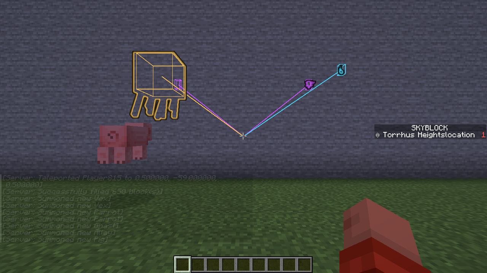

# Hunting Helper 1.5.0

Open **/hh → Custom trackers** or **/hh custom** to manage as many rules as you need. Each has its own switch, line color and model glow.

- **Nametag** reads floating SkyBlock armor stands, text displays and names attached directly to mobs. Enter **Revenant Sycophant** for the miniboss, or **rev** for partial Revenant names and the Tier V **Atoned Horror**.
- **Mob type** accepts IDs such as **wither_skeleton** and **zombie** across their different SkyBlock names.
- **All Safari settings** on the new **/hh** dashboard opens the full bundled Sparkling Mutuals 4.3.7 suite, including party sync. Its Kotlin runtime and upstream notices ship in the same JAR.
- The ivory-and-honey Frost Hivethief unfolds into the charcoal dashboard and settles into its header.
- The charcoal settings screen opens with a shorter Hivethief fade. Five presets and the custom library share a six-card grid. A separate, rebindable settings key is available in Minecraft Controls.
- Rules save on disk and run together across all loaded entities in the effective client render distance. The five original hunting presets keep their original names and location rules.

Minecraft 26.2 · Fabric Loader 0.19.5+ · Fabric API 0.161.0+26.2 · Java 25

# Hunting Helper 1.4.0

A matte charcoal redesign and five Hypixel hunting trackers.

- **Parched** and **Pollendart** join Vex, Blue Jay and Hivethief, each with independent Line and Glow colors.
- Smaller icons and an adaptive two-row layout fit all five trackers at the usual GUI size. Compact windows retain scrolling and keyboard navigation.
- Hypixel nametags remain authoritative. Every loaded entity across the full render distance is checked on every client tick; a reusable horizontal index speeds up pairing without adding a tracking radius or a height limit.
- Through-wall model outlines gain a light matching tint and full-distance rendering for small mobs. Glow **Off** disables both outline and tint.
- **Match line**, separate colors, saved settings, the Hivethief opening fade, **V**, and **F1** remain available.
- **`/hh`** opens settings; **`/hh debug`** toggles diagnostics. Debug logging and render counters stay idle while diagnostics are off.

Thanks to [evolveperformance](https://github.com/SleepCodeX/foragingPuckGrinding/pull/5) for the new trackers, nametag detection and glow improvements.

**Install:** Minecraft 26.2, Java 25, Fabric Loader 0.19.5+ and Fabric API 0.161.0+26.2. Replace the older Hunting Helper JAR.

Tests cover unit/config migration, the packaged Minecraft client, small and large menu layouts, palette controls, name pairing, movement, distance, tint, location/F1/master gates and entity removal. Live Hypixel and the user's complete modpack are not reproduced by CI.

# Hunting Helper 1.3.0

Smaller icons, wider card spacing and scrollable per-mob color dropdowns. A Hivethief fades into the settings header as the menu opens.

Native model glow shows tracked mobs through walls. Set **Line** and **Glow** independently; glow also offers **Match line** and **Off**. All choices persist.

Open **`/huntinghelper`**; **V** toggles your selection and **F1** hides overlays. Full loaded render-distance coverage is preserved.

**Install:** Minecraft 26.2, Java 25, Fabric Loader 0.19.5+ and Fabric API 0.161.0+26.2. Replace the older mod JAR. Source archive and checksums are included.
