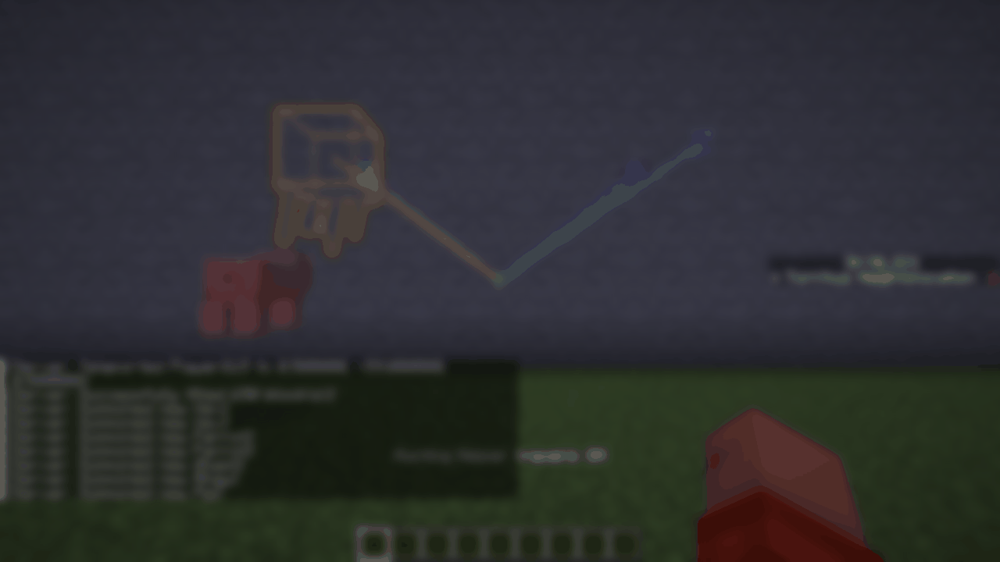

# Unreleased

- **Parched** (red) and **Pollendart** (green) trackers, Torrhus only, each with its own line and glow colors and a card in the menu. Cards wrap into rows; rows that do not fit scroll.
- **Nametag detection** for every tracker: Hypixel's floating name (for example `[Lv58] Parched`) is paired with the mob just below it. Parched and Pollendart use only their nametag, so plain bees and skeletons never match. Vex, Blue Jay and Hivethief keep their type detection as a fallback.
- A light see-through **tint** under the outline glow, in the glow color. Glow **Off** removes both.
- Glow now reaches as far as the tracer line for small mobs such as bees and Vex, and stays visible with the EntityCulling mod.
- **`/hh`** opens the menu; **`/hh debug`** (or `/huntinghelper debug`) writes a detection summary to `latest.log` every 5 seconds.

# Hunting Helper 1.3.0

Smaller icons, wider card spacing and scrollable per-mob color dropdowns. A Hivethief fades into the settings header as the menu opens.

Native model glow shows tracked mobs through walls. Set **Line** and **Glow** independently; glow also offers **Match line** and **Off**. All choices persist.

Open **`/huntinghelper`**; **V** toggles your selection and **F1** hides overlays. Full loaded render-distance coverage is preserved.

**Install:** Minecraft 26.2, Java 25, Fabric Loader 0.19.5+ and Fabric API 0.161.0+26.2. Replace the older mod JAR. Source archive and checksums are included.
