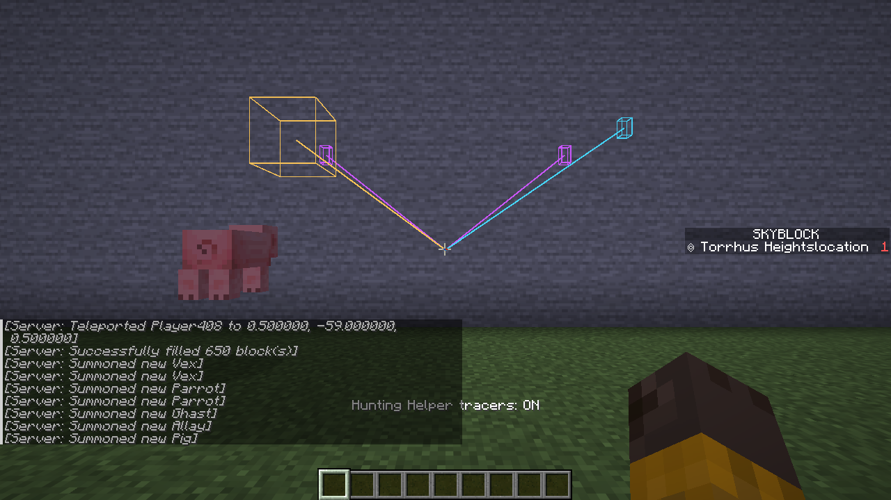
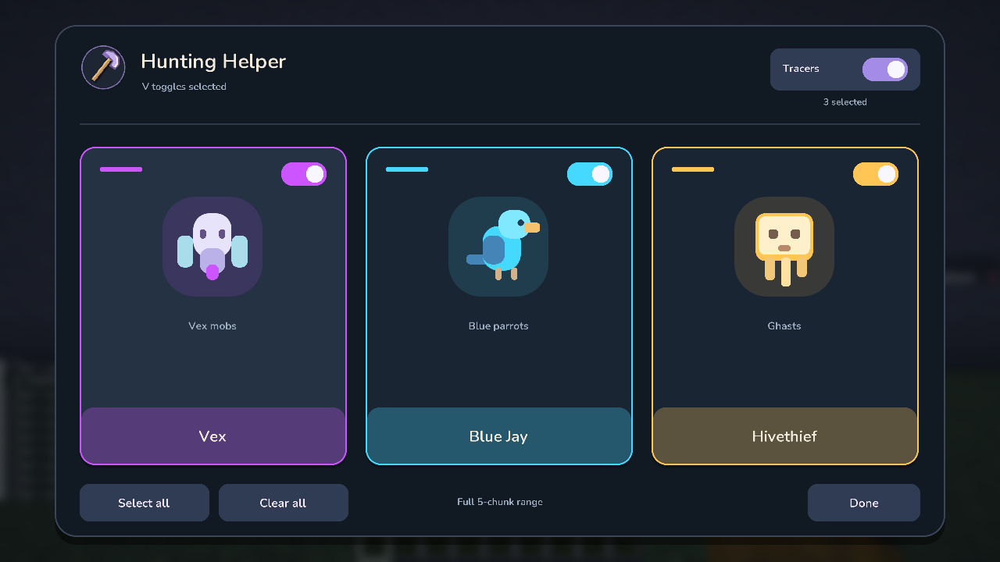

# Hunting Helper 1.2.0

**Purple Vex · Cyan Blue Jay · Gold Hivethief (Ghast)**

Independent mob toggles, **Select all / Clear all**, and matching wire boxes.
The scan now covers every loaded chunk in your render distance, including corners.
Reused discovery buffers and cached range bounds keep frame work small.

A cleaner OneClient-inspired menu with original mob icons, responsive cards and a quick opening fade.
Open **`/huntinghelper`**; **V** toggles the selected trackers.

**Install:** Minecraft 26.2, Java 25, Fabric Loader 0.19.5+ and Fabric API 0.161.0+26.2.
Replace the old tracer JAR. The source JAR, checksums and source commit information are included below.
