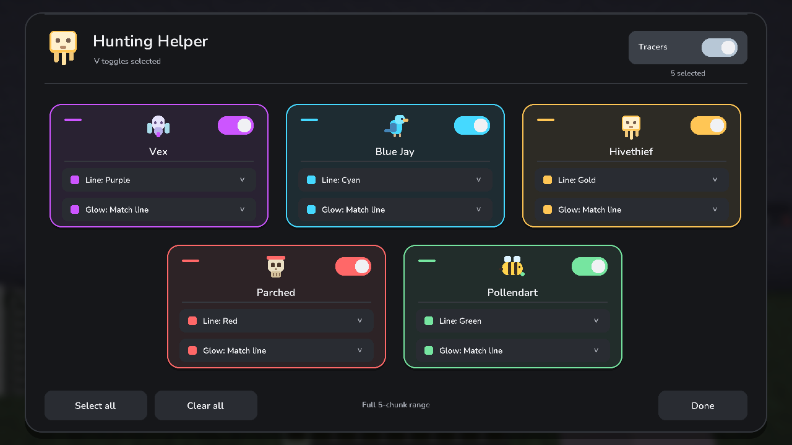
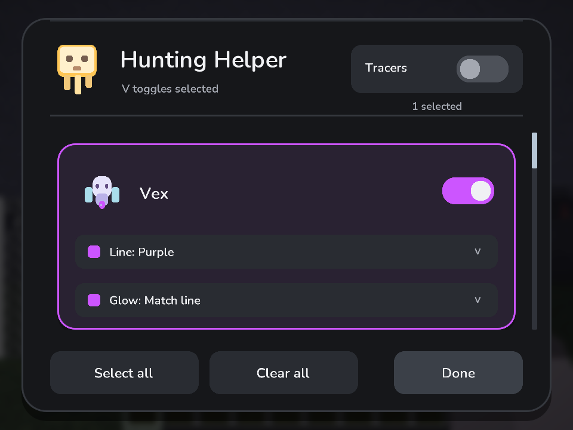
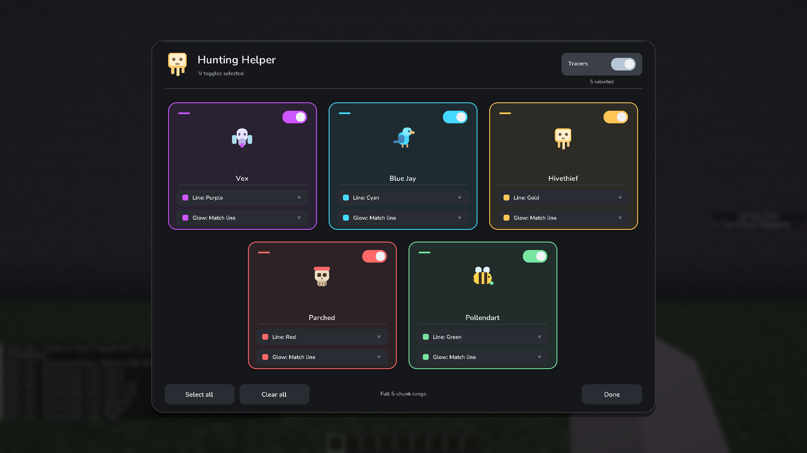
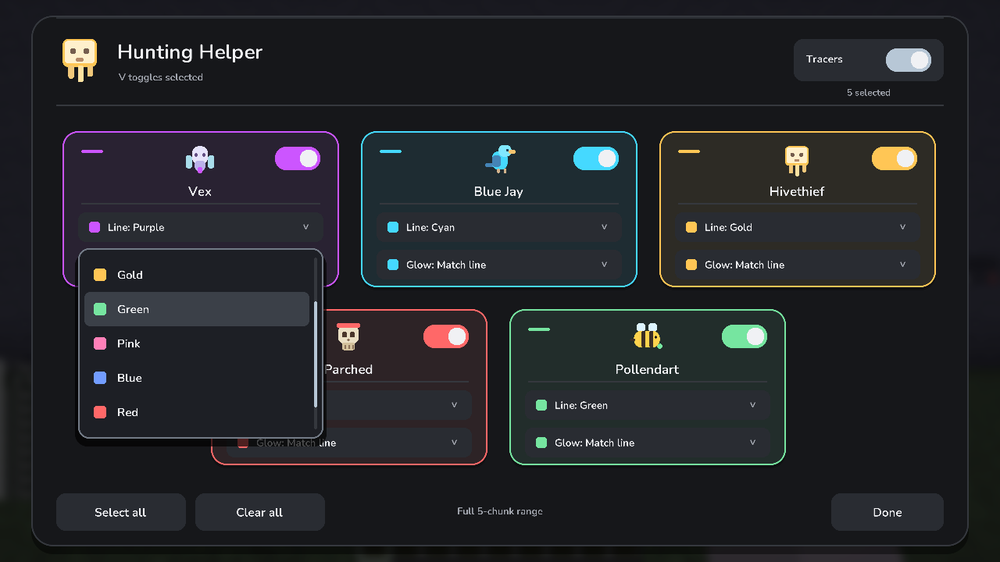
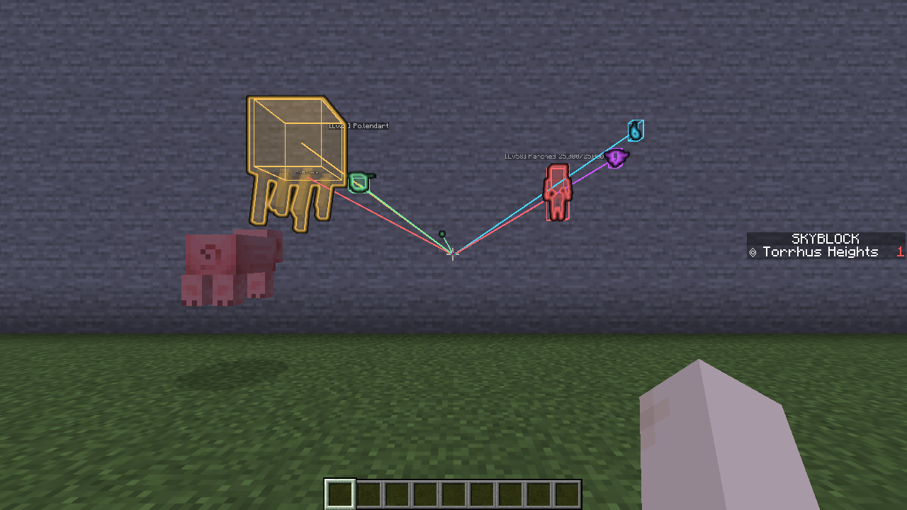
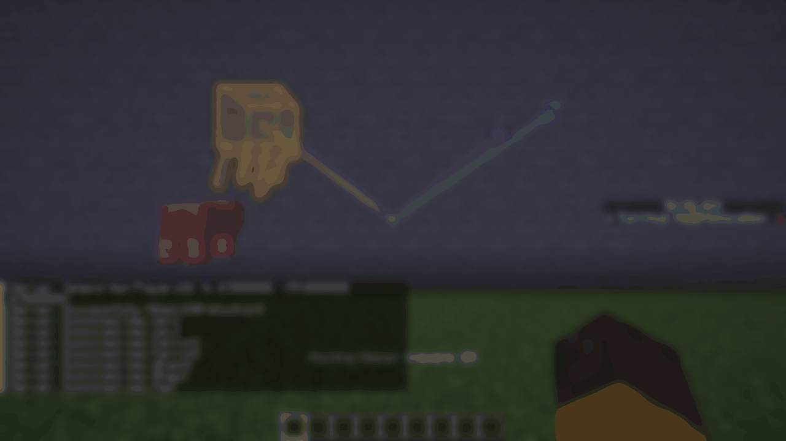

# Hunting Helper 1.4.0 visual guide

Captured by the packaged Minecraft 26.2 client test on GitHub, using Mesa software rendering.

The usual 1280 × 720 window at GUI scale 2 shows all five targets and their independent Line and Glow controls.
The smaller icons leave room for settings. The second row is centered.

At 960 × 720 and GUI scale 3, the menu uses one scrollable column. Tab reveals focused controls; Home/End and Page Up/Down scroll.

The scrollable palette retains Match line and Off for Glow, separate Line colors and saved selections.

The stone wall hides the mobs' normal models. Tracers, boxes, model outlines and a light tint show tracked mobs through it.
Parched and Pollendart require their Hypixel-style floating name; ordinary unnamed bees and skeleton variants stay untracked.

The existing nonblocking opening fade remains. Captures use a deterministic clock.
