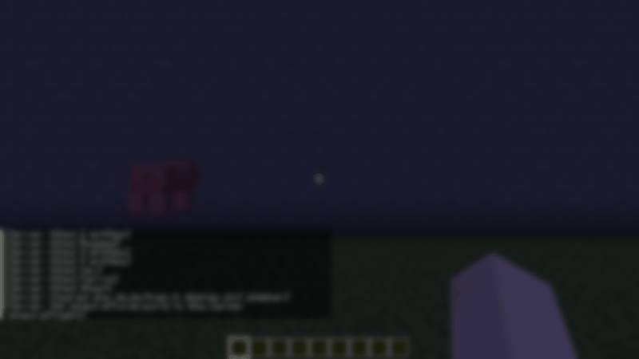
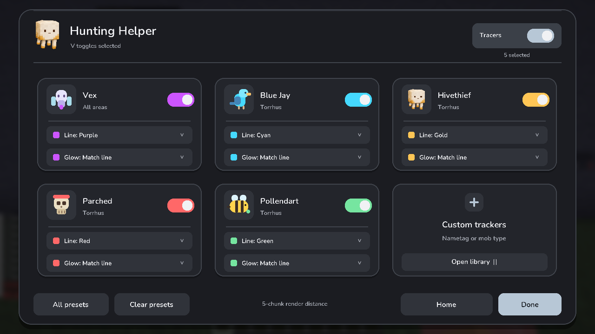
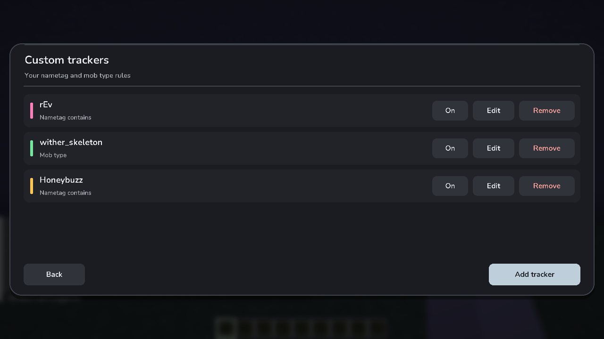
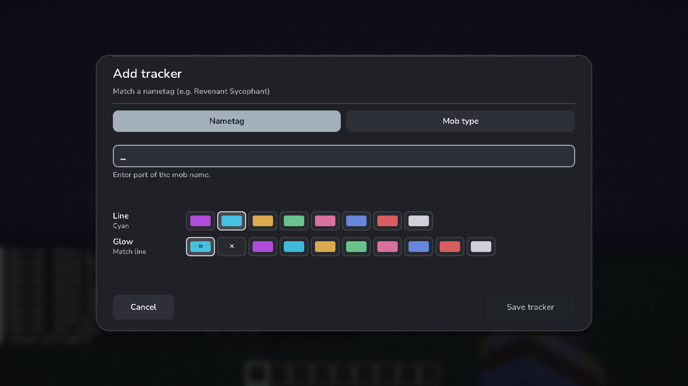
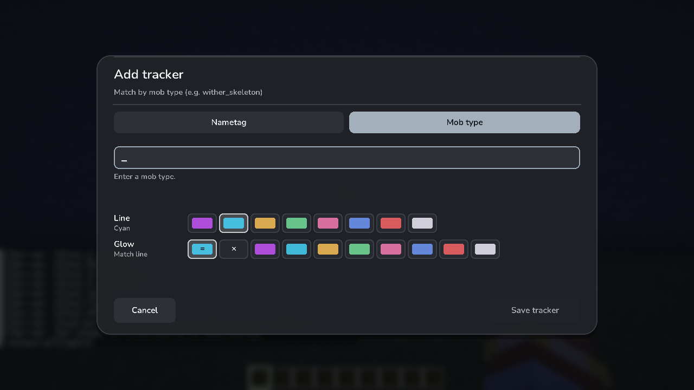
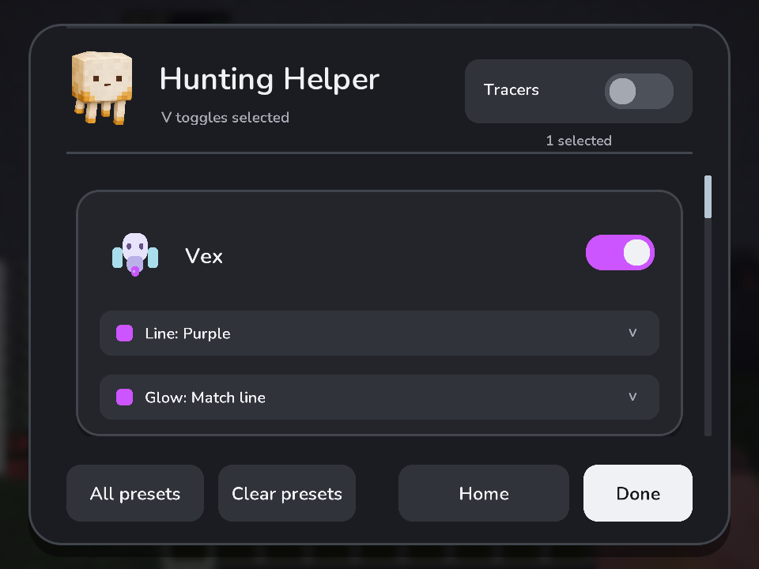
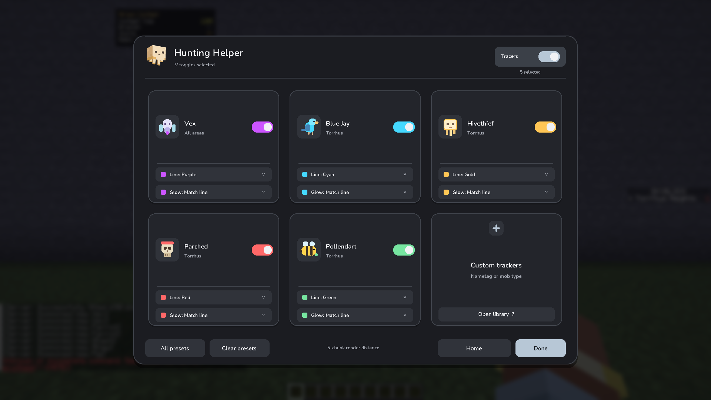
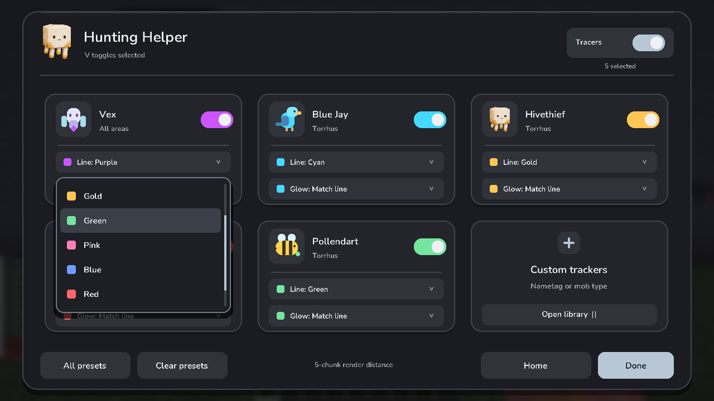
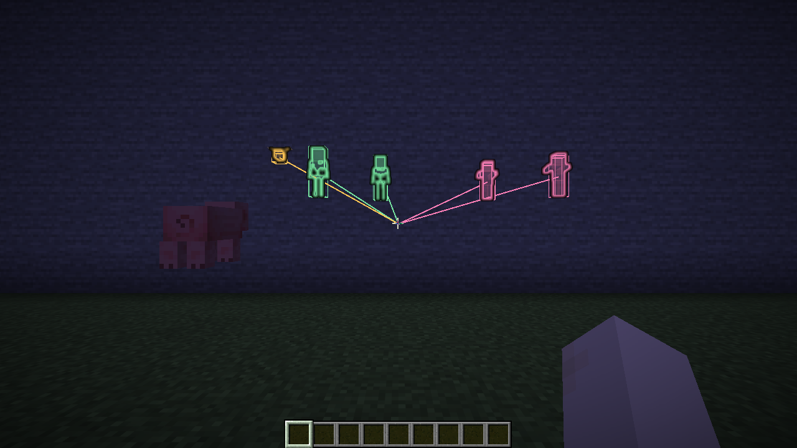
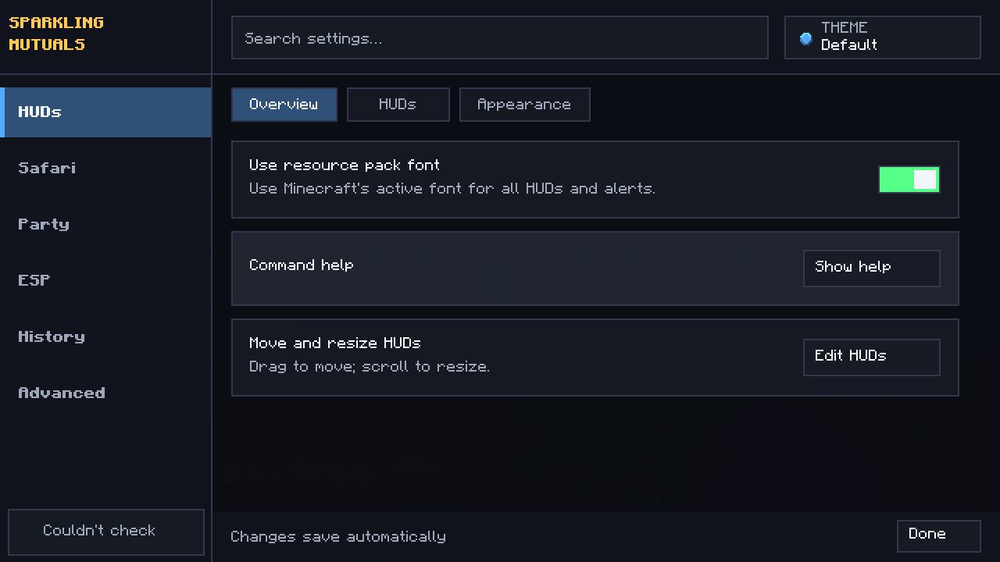

# Hunting Helper 1.5.0 in Minecraft

| Settings | Custom trackers |
| --- | --- |
|  |  |
|  |  |
|  |  |
|  |  |

The packaged Fabric client generated these images in a simulated SkyBlock scene.

